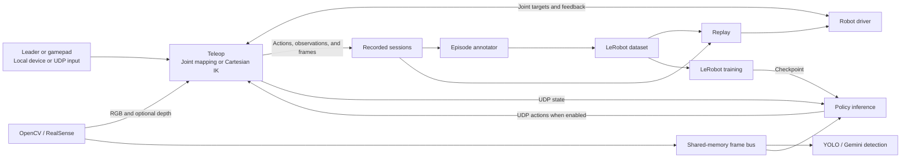

# Revobots Arm

Control a robot arm from a leader arm, a gamepad, a Cartesian target, or a trained LeRobot policy. Record actions, robot feedback, and camera frames together, then use those recordings for dataset creation and replay.

## Features

| Area | What you can do |
| --- | --- |
| Robots | Use the native seven-joint AgileX Nero CAN driver, the Nero LeRobot follower adapter, or Koch, SO-100, and SO-101 follower adapters. |
| Local arm console | Configure the follower, leader or gamepad, and cameras. Preview joint or tool moves, calibrate hand–eye, run policies, and use Hover and grasp. |
| Teleoperation | Connect a local or UDP leader or gamepad. Use joint copy for compatible devices or follow the leader's tool pose with Cartesian IK. |
| Cartesian motion | Command XYZ and roll, pitch, and yaw on Nero and SO-101 from the CLI. Read the current pose or dry-run an IK target. |
| Cameras | Discover and preview OpenCV or RealSense cameras, capture RGB and optional RealSense depth, publish frames through shared memory, and stream RGB over RTSP. |
| Data | Record manually marked, timed, or continuous sessions. Browse and label episodes in a local web UI, convert them to LeRobot datasets, and replay recorded actions. |
| Policy inference | Run a trained LeRobot checkpoint alongside teleop and switch between human and policy control. |
| Vision and hand–eye | Run YOLO or Gemini detection on a selected feed. Calibrate a native Nero wrist camera from live ChArUco views or a recording. |
| Hover and grasp | Select a point on the Nero wrist camera, preview a tabletop move, and confirm it in a local browser. |

## Control and data pipeline



Run teleop or replay as the hardware owner. The remote input client sends leader angles or gamepad state to the robot PC. Inference uses the camera frame bus on the robot PC and returns actions to the teleop process. Vision can read the same feeds and write detections alongside a run.

## Install

Use Python 3.10 or newer, subject to the requirements of your compatible LeRobot checkout and hardware SDK. Install both packages from the repository root.

```sh
python -m pip install -e .
python -m pip install -e /path/to/compatible-lerobot
```

Install the [hardware driver](src/revobots_arm/robots/) for your arm. Native Nero uses `pyAgxArm`. The LeRobot checkout must provide the adapters you use and, for policy inference, `lerobot.scripts.lerobot_inference_api`.

| Optional feature | Dependency |
| --- | --- |
| Gamepad | `python -m pip install -e ".[gamepad]"` |
| RealSense | `python -m pip install -e ".[realsense]"` |
| YOLO | `python -m pip install -e ".[vision-yolo]"` |
| Gemini | `python -m pip install -e ".[vision-gemini]"` |
| RTSP | System GStreamer, PyGObject, and GstRtspServer on Linux or Jetson |
| ChArUco calibration | An OpenCV build with `cv2.aruco.CharucoDetector` |

## Quick start

The examples below use a POSIX shell. Replace example IP addresses, camera sources, and device paths with yours. On Windows a serial device is typically a `COM` port.

### Local browser console

Run this on the computer connected to the follower and cameras. The command opens a browser at `127.0.0.1:8766`. If it does not open automatically, use the full URL printed in the terminal, including the token.

```sh
revobots-arm-control --preset nero_gamepad
```

1. Open **Setup**. Choose the follower, enter its CAN or serial settings, and select the input. Use **Add camera** for each OpenCV or RealSense camera. For Hover and grasp, enable RealSense depth and select it under **Grasp camera**.
2. Click **Connect**. The **Live view** panel shows camera frames and measured joints. **Joints** previews individual motor targets on native Nero, Koch, SO-100, and SO-101. **Tool pose** accepts XYZ in millimetres and roll, pitch, and yaw in degrees on native Nero. SO-101 tool moves use XYZ and require joint positions in degrees.
3. In **Teleop**, click **Start teleop** after selecting a leader or gamepad. Hold LT to jog with a gamepad. For joint mapping into Nero, use the mapped follower with the existing UDP leader client. Use its destination `127.0.0.1` when running the client on the same machine. For native Nero, select **Cartesian IK** for leader motion.
4. In **Hand–eye**, download the ChArUco board, enter the measured square and marker dimensions, and capture at least six distinct settled views. Use **Solve and save** to write a JSON calibration or load an existing calibration in **Hover and grasp**.
5. In **Hover and grasp**, enter the measured tool and table geometry and click **Apply grasp setup**. Click a point in the wrist camera, preview a path, and confirm it. Grasping requires both gripper positions.
6. In **Policy**, enter the checkpoint, training dataset repo ID, and optional task. Preview its first predicted action, then click **Run policy**. This uses the same LeRobot inference API as the CLI and the cameras already connected in Setup.

The default launch allows feedback and previews. Relaunch with `--execute` to enable confirmed moves and start teleop. **Stop motion** cancels an active operation and requests a position hold during motion. Keep the separate teleop, replay, and standalone grasp commands closed while the browser console owns the arm. Paths are on the computer running the console.

A local leader or USB gamepad plugs into the computer running the console. A remote leader or gamepad uses its existing `revobots-arm-leader-client` or `revobots-arm-gamepad-client` on the other computer. Use the controller computer's IP and the listen port from **Setup**. The control page itself listens on loopback.

### Gamepad on the robot PC

With the gamepad connected to the robot PC, use `nero_gamepad` for native Nero or `so101_gamepad` for SO-101.

```sh
revobots-arm-teleop --preset nero_gamepad \
  --robot.channel=can-nero --robot.rest_on_start=false --cameras=none
```

The example disables the Nero preset's startup rest move and omits cameras for a motion-only setup. The default Nero gamepad preset uses SocketCAN, firmware profile `v121`, and saved X/Y/B pick, place, and look poses. LB opens the gripper and RB closes it. Check the configured CAN channel, firmware profile, camera sources, and saved poses before using a preset on a different robot. The `nero_gamepad` and `so101_gamepad` presets start at 1.5× jog speed. Use `--teleop.initial_speed_level=2` for 0.5×.

### Gamepad on a separate PC

```sh
# Robot PC
revobots-arm-teleop --preset nero_gamepad --port=5001 --robot.rest_on_start=false

# PC with the gamepad
revobots-arm-gamepad-client --ip=192.168.1.20 --port=5001
```

Use the robot PC's IP and the same UDP port on both sides. Omit `--port` on the robot PC for a local gamepad.

### Presets and deployment profiles

| Preset | Default setup |
| --- | --- |
| `nero` | Nero follower and a remote Koch leader |
| `nero_cartesian` | Native seven-joint Nero with gamepad Cartesian control and no gripper configured |
| `nero_gamepad` | Native Nero with gamepad, gripper, and saved poses |
| `koch` | Koch follower and a remote Koch leader |
| `so101` | SO-101 follower and local SO-101 leader |
| `so101_remote` | SO-101 follower and remote SO-101 leader |
| `so101_gamepad` | SO-101 follower and gamepad |

For other configurations, set `--robot.type` and `--teleop.type` explicitly with the settings for those drivers. Each type override replaces that section's preset values. For repeatable deployments, save dotted overrides in JSON and pass `--deployment robot.json` or set `REVOBOTS_ARM_DEPLOYMENT`. CLI overrides take precedence over the deployment file, then the preset. See [presets](src/revobots_arm/config/presets.py) and the [configuration schema](src/revobots_arm/config/schema.py).

## Leader and Cartesian control

Enable `--ik=true` to follow a leader's tool motion. The first paired reading anchors both tools. The runtime computes the leader's pose change with forward kinematics and solves follower joint targets with IK. With Nero as the follower, it uses the native seven-joint driver and skips the startup rest move. The gripper holds its measured setting when available.

### Nero + Koch leader with Cartesian IK

```sh
# Same PC, with the Koch leader plugged into the robot PC
revobots-arm-teleop --preset nero --ik=true \
  --teleop.type=koch_leader --teleop.port=/dev/ttyACM0 \
  --teleop.id=rahul --ik.leader_calibration=rahul --cameras=none

# Separate PCs. Run the first command on the robot PC and the second on the leader PC.
revobots-arm-teleop --preset nero --ik=true --cameras=none
revobots-arm-leader-client --preset nero --ik=true --ik.leader_calibration=rahul \
  --ip 192.168.1.20 --port 5001 --com /dev/ttyACM0 --id rahul
```

The examples select the measured Koch calibration named `rahul`. For a different Koch leader, use its calibration ID and joint signs and offsets. Apply those settings on the machine connected to the leader.

### Nero + SO-101 leader with Cartesian IK

```sh
# Same PC, with the SO-101 leader plugged into the robot PC
revobots-arm-teleop --preset nero --ik=true \
  --teleop.type=so101_leader --teleop.port=/dev/ttyACM1 \
  --teleop.id=bench_leader --cameras=none

# Separate PCs. Robot PC and leader PC, respectively.
revobots-arm-teleop --preset nero --ik=true \
  --teleop.type=so101_leader_remote --teleop.port=5002 --cameras=none
revobots-arm-leader-client --preset nero --ik=true --teleop.type=so101_leader_remote \
  --ip 192.168.1.20 --port 5002 --com /dev/ttyACM1 --id bench_leader
```

### Nero + Koch or SO-101 leader with joint mapping

Joint mode uses the Nero LeRobot follower and the matching LeRobot leader-client mapping. On one PC, run both commands in separate terminals and set the receiver host and client IP to `127.0.0.1`. On separate PCs, omit the receiver's `--teleop.host` override and set the client's `--ip` to the robot PC's LAN or Tailscale address. Use matching ports on each pair.

```sh
# Koch → Nero, terminal 1
revobots-arm-teleop --preset nero --teleop.host=127.0.0.1 --cameras=none

# Koch → Nero, terminal 2
revobots-arm-leader-client --preset nero \
  --ip 127.0.0.1 --port 5001 --com /dev/ttyACM0 --id bench_koch

# SO-101 → Nero, terminal 1
revobots-arm-teleop --preset nero --teleop.type=so101_leader_remote \
  --teleop.host=127.0.0.1 --teleop.port=5002 --cameras=none

# SO-101 → Nero, terminal 2
revobots-arm-leader-client --preset nero --teleop.type=so101_leader_remote \
  --ip 127.0.0.1 --port 5002 --com /dev/ttyACM1 --id bench_leader --use-degrees
```

SO-101 joint mapping requires a compatible LeRobot sender with `is_follower_nero` support. Its arm-joint signs and offsets are identity in the bundled REVOCORTEX mapping. Check the mapping against your physical leader and follower before moving the arm.

### Cartesian tuning and direct moves

Koch-to-Nero Cartesian mode defaults to 2.75× translation and aligns the starting tool headings. Other pairs default to 1:1 translation with aligned base axes. Define a different setup with `--ik.position_scale` and `--ik.frame_rpy_deg`. Set `--ik.orientation_weight=0` for XYZ-only tracking. Enable Nero wrist priority with `--ik.wrist_priority=true` for a leader or `--teleop.wrist_priority=true` for gamepad control.

For a direct target, use the robot-specific IK command. XYZ is in metres and roll, pitch, and yaw are in degrees. SO-101 has five arm joints and can only track the orientations reachable at the requested position.

```sh
# Hardware-free Nero dry run from seven seed joint angles in degrees
revobots-arm-nero-ik --seed_deg=0,20,0,60,0,10,0 --z=0.40 --dry_run

# Read the connected SO-101's tool pose
revobots-arm-so101-ik --preset so101 --print_pose
```

Nero's IK CLI defaults to `link7`. Use `--tip_link=gripper_tcp` for the nominal AGX grasp reference and supply a measured tool offset when needed. The planner checks reachability, joint limits, and joint motion limits. See [Nero IK](src/revobots_arm/inverse_kinematics/nero.py) and [SO-101 IK](src/revobots_arm/inverse_kinematics/so101.py).

## Cameras, streaming, and depth

```sh
revobots-arm-cameras find
revobots-arm-cameras --preset nero_gamepad test --cameras.eye.source=0
revobots-arm-cameras --preset nero_gamepad preview --cameras.eye.source=0
```

Set `--cameras.<name>.source` to an OpenCV device index or path. For RealSense, use `--cameras.<name>.type=intelrealsense` with a serial number or unique device name. RealSense captures RGB and adds raw depth in millimetres when `use_depth=true`. Enable `publish_frames` for local consumers such as vision and policy inference.

The same camera settings work for all the teleop recipes. Put them on the robot PC's `revobots-arm-teleop` command. Leave `--cameras=none` in place for a motion-only run, or replace it with one of these camera configurations.

| Camera setup | Teleop flags |
| --- | --- |
| USB colour | `--cameras.eye.source=0` |
| RealSense colour | `--cameras.wrist2D.type=intelrealsense --cameras.wrist2D.source=CAMERA_SERIAL` |
| RealSense colour and depth | The RealSense colour flags plus `--cameras.wrist2D.use_depth=true` |
| RTSP and depth telemetry | Enable depth, then add `--stream.enabled=true` and select a colour feed with `--stream.camera=eye` or `--stream.camera=wrist2D`. |

```sh
revobots-arm-teleop --preset nero_gamepad --robot.rest_on_start=false \
  --cameras.eye.source=/dev/video0 \
  --cameras.wrist2D.type=intelrealsense --cameras.wrist2D.source=CAMERA_SERIAL \
  --cameras.wrist2D.use_depth=true \
  --stream.enabled=true --stream.camera=eye --stream.port=8556
```

The example serves the `eye` colour feed at `rtsp://<robot-ip>:8556/ai`. With streaming enabled, the runtime can publish a **3 Hz distance reading** for each active RealSense depth feed. The reading is the median of valid pixels in an 11×11 patch at the centre of the **depth image**. Raw depth is unaligned to colour. The default destination is UDP `127.0.0.1:57110`. The standalone worker can publish with RTSP off. Run it on the camera-owning PC with a depth feed already publishing frames.

```sh
revobots-arm-depth --camera wrist2D --robot-id XAVIER_PORTER_001
```

For Porter, use the **base's fleet ID** in `--stream.depth_robot_id` or `--robot-id` and match the base's `arm_depth_camera` with `arm_depth_enabled` turned on. A receiver on another PC needs `--stream.depth_host` or `--host` set to its private IP. Scout needs the corresponding base-side receiver. Keep the unauthenticated UDP telemetry on a private network. See the [depth worker](src/revobots_arm/telemetry/depth.py).

## Record, annotate, convert, and replay

In teleop, **Space** starts or stops a recording. **Left / R** redoes a take, and **Esc / Q** quits. Use any of the teleop recipes above and add `--run_dir ./runs/workbench` to choose where to save. For a continuous run, add `--record.continuous=true`. It starts when teleop is ready, ignores the manual recording keys, and finalizes at exit.

```sh
# Press Space to start and stop each take
revobots-arm-teleop --preset nero_gamepad --robot.rest_on_start=false \
  --cameras.eye.source=0 --run_dir ./runs/takes

# Record one continuous take, then exit before opening the annotator
revobots-arm-teleop --preset nero_gamepad --robot.rest_on_start=false \
  --cameras.eye.source=0 --record.continuous=true --run_dir ./runs/workbench

# After the recording is finalized
revobots-arm-episode-annotate ./runs/workbench --output ./runs/curated
```

Use `revobots-arm-record` with the same robot, input, and camera configuration for timed episode capture.

The local annotator accepts a run directory, a finalized `session_<n>` folder, or its `data.jsonl`. It binds to `127.0.0.1` and opens a browser with a per-launch URL token.

1. Pick the camera or enable the all-camera view. Use the timeline to scrub, **Left / Right** to step, or **K** to play or pause.
2. Press **Space** at the start and the last frame to keep, or use the on-screen mark button. Adjust the range and task label in the episode list.
3. Choose **Export sessions** to write the selected ranges to a new directory while preserving the originals. **Export + convert to LeRobot** also builds a local dataset.

```sh
# Convert the directory printed by the episode exporter
revobots-arm-convert --sessions_dir /path/to/exported-run \
  --dataset.repo_id=your-org/workbench

# Replay with the same follower and action schema used while recording
revobots-arm-replay --preset nero_gamepad --robot.rest_on_start=false \
  --session_dir ./runs/workbench/session_0

# Replay a converted LeRobot episode
revobots-arm-replay --preset nero_gamepad --robot.rest_on_start=false \
  --dataset.repo_id=your-org/workbench --dataset.episode=0
```

To replay a LeRobot episode, pass `--dataset.repo_id` and `--dataset.episode` in place of `--session_dir`. The converter saves locally by default and uploads only when `--dataset.push_to_hub=true` is set. Match joint names, units, and camera keys across recording, conversion, replay, and inference.

## Run policy inference

Start teleop with the AI link enabled and run inference on the same PC so it can read the shared-memory camera feeds. This example assumes a checkpoint trained with native Nero gamepad actions and an `eye` camera. Replace both configurations with the robot and camera keys from your dataset if they differ. In particular, the mapped Nero joint schema and the native seven-joint schema use different action keys.

```sh
# Terminal 1
revobots-arm-teleop --preset nero_gamepad --robot.rest_on_start=false \
  --cameras.eye.source=0 --ai.enabled=true

# Terminal 2
revobots-arm-inference --preset nero_gamepad --cameras.eye.source=0 \
  --policy.path=./outputs/checkpoint/pretrained_model \
  --dataset_repo_id=your-org/workbench
```

Teleop owns the hardware and passes state and actions over UDP. Press **A** in teleop to give the policy control. Press **A** again to take it back. On a leader setup configured for human takeover, moving the leader also returns control. The AI link defaults to loopback and uses ports `5010` for actions and `5011` for state.

## Vision detection

Run a detector on an image, a live colour camera, or a finalized recording. The output is JSONL with detection boxes in original-image pixels. YOLO can also produce segmentation outlines and track IDs with a compatible model and tracker.

```sh
revobots-arm-vision yolo --image sample.jpg \
  --model /path/to/checkpoint.pt --annotated boxes.jpg

revobots-arm-vision yolo --camera wrist2D --follow \
  --model /path/to/checkpoint.pt --tracker bytetrack.yaml --max-fps 10
```

For a recording, add `--session /path/to/session_0` to the camera command. For text-prompt detection, use `revobots-arm-vision gemini` with `--model` and `--prompt`, and set `GEMINI_API_KEY` or `GOOGLE_API_KEY`. Gemini sends the processed images to Google.

Teleop can launch vision as a child process. Put `--vision` and the detector arguments last. With continuous recording, the default output is `vision.jsonl` in the run directory. Use `--vision-output` before `--vision` to set a different file.

## Nero wrist hand–eye calibration

The calibrator reads a finalized native Nero recording and saves colour intrinsics and the fixed camera-to-`link7` transform. It works offline on the recording.

```sh
revobots-arm-hand-eye board --output charuco.png
revobots-arm-hand-eye calibrate --session ./runs/calibration/session_0 \
  --camera wrist2D --square-mm 35 --marker-mm 26 --output ./nero_wrist.json
```

Print the ChArUco board and measure the printed squares and markers. Keep the board and robot base stationary while recording 12–20 wrist views with measured feedback from all seven joints. Vary the wrist angle around at least two axes, the distance, and the position of the board in the image. Hold each view for about a second. The tool selects settled views and reports reprojection and board-pose errors.

Use the calibration with the same camera mount and image geometry. To map a detection pixel into robot coordinates, `pixel_to_base()` needs depth aligned to colour and the wrist pose at image capture. The grasp camera provides aligned depth to Hover and grasp and raw depth to the existing camera observation channel.

## Hover and grasp on Nero

Open **Hover and grasp** in the local arm console or start the standalone command below.

The local console follows REVOCORTEX's mark, plan, and execute workflow for top-down tabletop picks. It owns the native Nero driver and the calibrated wrist RealSense while it runs. Stop teleop, replay, and any other process that is using those devices before starting the console.

Set `TCP_XYZ_M` to your measured grasp point in `gripper_base` as three comma-separated values in metres. Set `TABLE_Z_M` to the measured height of the work surface in `base_link` on an upright robot. Configure the same camera serial, resolution, and rotation used for hand–eye calibration. Use `--tcp-rpy-deg` if your measured tool axes differ from `gripper_base`. Tool +Z points in the approach direction.

```sh
# Preview first. Set TCP_XYZ_M and TABLE_Z_M for your setup before running.
revobots-arm-grasp --preset nero_gamepad --calibration ./nero_wrist.json \
  --tcp-xyz-m="$TCP_XYZ_M" --table-z-m="$TABLE_Z_M" \
  --cameras.wrist2D.type=intelrealsense --cameras.wrist2D.source=CAMERA_SERIAL \
  --cameras.wrist2D.use_depth=true \
  --robot.gripper_mode=width --gripper-open=0.070 --gripper-close=0
```

Replace the gripper positions with values that fit your setup. The example uses a 70 mm opening in Nero's width mode, whose command unit is metres. For hover only, omit both gripper positions. The console opens on `127.0.0.1`. Add `--no-browser` to print the URL for manual use.

1. Hold the arm still and click the visible top of the object. The console uses the paired colour and aligned depth data and projects the selection into robot-base XYZ.
2. Set hover height, grasp depth below the selected surface, and jaw yaw. **Preview hover** moves to the waypoint when executed. **Preview grasp** plans travel above the object, opening, descent, closing, and lifting.
3. Once you have verified the preview on your setup, restart with `--execute`. Preview the move again and select **Execute plan** within 20 seconds. **Stop** cancels the remaining motion and requests a hold.

Preflight checks reachability, joint limits, travel, and tabletop clearance for the tool point, wrist, and camera. Keep the path clear of fixtures and other objects. The selected point assumes the object stays still. A completed grasp sequence reports that the commands finished. Confirm that the gripper actually picked up the object.

## Machine info and diagnostics

```sh
# Inspect the local host without connecting to an arm
revobots-arm-info --preset nero_gamepad

# Check installed Python dependencies
revobots-arm-test

# Open a read-only native Nero feedback connection. Stop teleop and replay first.
revobots-arm-test --preset nero_gamepad --robot --seconds 2

# Read a local SO-101 leader's serial bus directly. Leave the port free.
revobots-arm-test --preset so101 --leader --teleop.port=/dev/ttyACM1

# While the camera owner runs, check colour and depth frame rate, format, and age
revobots-arm-test --camera wrist2D --camera wrist2D_depth --seconds 3

# With the teleop UDP receiver stopped, verify that input packets reach the robot PC
revobots-arm-test --udp-port 5001 --seconds 5
```

`revobots-arm-info` reports the machine, Python environment, configured robot and input endpoints, detected serial ports and cameras, Linux CAN interfaces, and local Tailscale addresses. Detected ports are device candidates. Pass `--robot` or `--leader` to verify that a supported device responds with readable positions. These probes leave joint targets and torque settings alone. A native Nero probe reads the seven arm joints. Serial Koch and SO probes report raw encoder counts. [Tailscale CLI reference](https://tailscale.com/docs/reference/tailscale-cli#ip)

The test command reports median, p95, and maximum where it has timing samples. Motor read time measures the driver call. Camera age uses the frame bus timestamp on the same host. UDP reports packet counts and time **between arrivals**, which helps diagnose delivery gaps. Both commands accept `--json`. The shorter aliases `revobot-arm-info` and `revobot-arm-test` also work.

## Development

Core code lives under [`src/revobots_arm`](src/revobots_arm). Register new robot and input adapters in the [robot registry](src/revobots_arm/robots/registry.py) and [teleoperator registry](src/revobots_arm/teleoperators/registry.py). For Cartesian control, specify the URDF, base and tip links, joint order, and the mapping from calibrated motor readings to URDF joints. The [CLI entry points](pyproject.toml) list all installed commands, and each accepts `--help`.

Run the hardware-free tests with the base package installed.

```sh
python -m unittest discover -s tests -v
```
